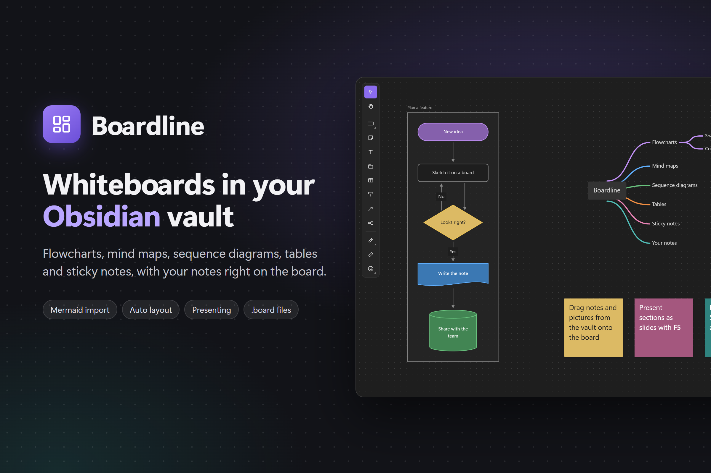

# Boardline

[English](README.md) · 한국어

Obsidian 보관함 안에서 쓰는 화이트보드 플러그인이다. 플로차트·마인드맵·시퀀스 다이어그램·표·스티키 노트를 그리고, 보관함의 노트·그림·다른 보드를 함께 올려 둔다. 보드 하나가 `.board` 파일 하나이고, 서버나 계정 없이 보관함 안에만 저장한다. 휴대폰·태블릿의 Obsidian에서도 동작하도록 만들었다(두 손가락으로 확대·이동, 좁은 화면에서는 도구 막대가 아래로).



## 빌드와 개발

처음에는 `npm install`을 한 번 실행한다. Node 22 이상이 필요하다.

| 목적 | 명령 |
|---|---|
| 플러그인 만들기 | `npm run build` → 저장소 최상위에 `main.js`, `styles.css` (커밋하지 않고 릴리스에 붙인다) |
| 개발 (고칠 때마다 다시 만들어 보관함에 넣기) | `npm run dev -- --vault <보관함 경로>` |
| 테스트 | `npm test` |
| 타입 검사 | `npm run typecheck` |
| Obsidian 리뷰 규칙 검사 | `npm run lint` (eslint-plugin-obsidianmd) |
| 데모 보드 사진 찍기 | `npm run screenshot -- out.png` (Edge나 Chrome 필요) |
| README·커뮤니티 디렉터리 이미지 다시 찍기 | `npm run listing` → `docs/listing/` (1200×800 비율, 2배 크기. README는 `1-boardline.png`) |
| 새 버전 | `npm version patch` (아래 [출시](#출시)) |

개인용으로 설치하려면 `main.js`, `styles.css`, `manifest.json`을 `<보관함>/.obsidian/plugins/boardline/`에 넣고, Obsidian 설정 > 커뮤니티 플러그인에서 Boardline을 켠다. 개발 중에는 `npm run dev -- --vault …`가 빌드할 때마다 파일을 넣어 주므로 Obsidian에서 `Reload app without saving`(Ctrl+R)만 하면 된다.

### 출시

1. `npm version patch`(또는 `minor`, `major`, `1.2.3`): `package.json`, `manifest.json`, `versions.json`의 버전을 올리고, 커밋하고, `v` 없는 태그(`1.0.1`)를 단다.
2. `git push --follow-tags`: GitHub Actions(`.github/workflows/release.yml`)가 태그가 `manifest.json` 버전과 같은지 보고, 검사·테스트·빌드 뒤 `main.js`, `manifest.json`, `styles.css`를 붙인 **초안 릴리스**를 만든다(빌드 출처 증명 포함).
3. GitHub에서 초안의 릴리스 노트를 다듬고 공개한다.

자세한 출시 준비와 커뮤니티 디렉터리 제출은 [docs/release.md](docs/release.md).

## 구조

보드 엔진, 보드 화면, Obsidian 셸의 세 층이다. 자세한 규칙은 [docs/architecture.md](docs/architecture.md).

```
src/
  core/            보드의 모든 것 (React·Obsidian 없음)
    engine/          Canvas 2D 엔진: 편집기(도구·선택·이동·텍스트·키보드·터치), 그리기, 연결선 경로, 스냅,
                     마인드맵·시퀀스·표·노트 카드, Markdown 글, 자동 정렬(ELK), 내보내기
    board/           보드 모델, 실행 취소, 파일 형식(.board), 버전 기록, 찾기, Mermaid, 링크, 그림 저장,
                     노트·캔버스로 내보내기
    theme/           보드 색(라이트·다크), 테마 이벤트
    icons/           아이콘 라이브러리(Phosphor)
    i18n/            화면 문구: t(키), 언어별 표(en 기준, ko·ja·zh·es·de·fr)
    platform/        저장소 인터페이스(WorkspaceStorage), 기기별 기억(prefs: 최근 색, 화면 위치 …)
  board-ui/        보드 화면 (React): BoardScreen, 도구 막대, 선택 막대, 찾기, 아이콘, 버전 기록 패널,
                   단축키 도움말, 발표 순서, board.css (bl- 클래스, --bl-* 색)
  main.ts          플러그인: 보기·명령·리본 등록, 파일 옮김에 따른 링크 고치기, 테마
  BoardFileView.tsx  .board 보기(TextFileView): 불러오기·저장, 버전 기록, 머리글 버튼과 메뉴
  vaultStorage.ts  Vault API로 만든 저장소
  dom.ts           엔진의 DOM 요소를 Obsidian의 createEl로(빌드가 @boardline/dom으로 넘김)
  dialogs.ts       링크·파일 고르기(SuggestModal), 글 입력(Modal)
  embeds.ts        노트 속 ![[x.board]] 그림
  linkFetcher.ts   웹 링크 미리보기(requestUrl)
  settings.ts      설정 탭
  plugin.css       Obsidian 테마 → --bl-* 색
scripts/
  icons-plugin.mjs   아이콘 데이터 모듈(esbuild·Vitest)
  architecture.test.ts  층 사이 의존 방향 검사
  gen-big-board.ts   성능 확인용 큰 보드 만들기
  app-cdp.mjs, cdp-profile.mjs  CDP로 Obsidian을 조작·프로파일
  version-bump.mjs   npm version이 manifest.json·versions.json 버전을 맞춤
  dom.ts             테스트·스크린샷용 @boardline/dom(DOM의 createElement)
  screenshot/        README 스크린샷: 데모 보드를 Vite로 띄워 헤드리스 Edge·Chrome으로 찍음
.github/workflows/  ci.yml(푸시·PR마다 검사), release.yml(태그를 밀면 초안 릴리스)
esbuild.config.mjs  플러그인 빌드 (저장소 최상위에 main.js, styles.css)
eslint.config.mjs   Obsidian 리뷰 규칙(eslint-plugin-obsidianmd)
manifest.json, versions.json  Obsidian 플러그인 정보
```

## 파일 형식

보드 하나가 `이름.board` 파일 하나다. 내용은 JSON으로, 첫 줄에 머리 정보, 그 아래 객체가 한 줄에 하나씩 있다(객체 하나를 고치면 한 줄만 바뀌어 diff가 깔끔하다).

```json
{"format":"boardline-board","version":1,"id":"…","title":"…","rev":3,"createdAt":"…","updatedAt":"…","objects":[
{"id":"…","type":"shape","shape":"rect","x":220,"y":200,"w":240,"h":60,"idealW":240,"idealH":60,"text":"…","color":"gray","deco":"outline","z":1},
{"id":"…","type":"shape","shape":"freehand","x":40,"y":40,"w":124,"h":64,"points":[2,2,40.5,30,120,60],"pen":"pen","color":"blue","deco":"outline","z":2}
]}
```

- 저장은 Obsidian이 한다(고칠 때마다 `requestSave`). 다른 기기에서 동기화로 바뀐 내용은 Obsidian이 알려 주고, 보드는 그것을 실행 취소할 수 있는 한 단계로 불러온다.
- `rev`는 보드가 바뀔 때마다 1씩 오른다.
- 화면 위치(뷰포트), 그리드 설정, 읽기 전용, 최근 색·아이콘은 파일이 아니라 이 기기에 기억한다(Obsidian의 보관함별 로컬 저장소, `App.saveLocalStorage`).
- 버전 기록은 보관함 안 `.boardline/history/<보드 id>/<UTC 시각>.json`에 보드 파일 그대로 저장한다. 보드 이름을 바꿔도 이어진다. 숨김 폴더라 Vault API가 다루지 못해 Adapter API로 읽고 쓴다.
- 붙여 넣은 그림과 링크 미리보기 그림은 보관함의 첨부 폴더(Obsidian 설정)에 내용 해시 이름으로 한 번만 저장한다. Obsidian Sync가 숨김 폴더는 옮기지 않기 때문이다. `.boardline/assets/`를 가리키는 그림도 읽는다.
- 설정을 켜면 보드 옆에 `이름.board.png`를 함께 둔다(아래 설정).

## 네트워크

링크 객체만 네트워크를 쓴다. 웹 주소를 넣으면 Obsidian의 `requestUrl`로 그 페이지와 그림을 읽어 제목·설명·사이트 아이콘·대표 그림을 가져온다. 그 밖의 네트워크 요청, 계정, 광고, 원격 측정은 없다.

## 쓰기

- **새 보드**: 왼쪽 리본의 보드 아이콘, 명령 팔레트의 `Boardline: 새 보드`, 파일 탐색기에서 폴더를 오른쪽 클릭 > `새 보드`.
- **보드 열기**: `.board` 파일을 누르면 보드 보기로 열린다.
- **머리글 버튼**: 발표, 버전 기록, 내보내기와 가져오기. 같은 항목이 `…` 메뉴에도 있다.
- **노트에 보드 넣기**: 노트에 `![[보드 이름.board]]`를 쓰면 보드 그림이 보인다(읽기 보기와 편집 화면 모두). 누르면 보드가 열리고, 보드를 고치면 그림도 바뀐다.
- **파일 옮기기·이름 바꾸기**: 보드에 올린 노트·그림·폴더를 옮기거나 이름을 바꾸면 모든 보드의 링크(노트 카드, 링크, 그림, 글 속 `[[링크]]`)가 따라간다. 열린 보드는 한 번의 실행 취소 단위로, 닫힌 보드는 파일에서 고친다. 보드끼리의 링크는 보드 id로 걸려 있어 그대로 이어진다.
- **명령**: 발표, 찾기·바꾸기, 버전 기록, 확대·축소·화면 맞춤, 자동 정렬, 내보내기, Mermaid 가져오기는 명령 팔레트의 `Boardline: …` 명령으로도 있다. 기본 단축키는 없고, 설정 > 단축키에서 원하는 키를 줄 수 있다(그러면 Obsidian의 단축키 충돌 검사에도 나온다).
- **키**: 보드 보기가 활성일 때만 보드가 받는다(Obsidian 캔버스처럼 보드 안의 키라 설정 > 단축키 목록에는 나오지 않는다). 겹치는 Obsidian 단축키(Ctrl+G, Ctrl+B/I/E/F/H/D/L/0/=/-, Ctrl+Enter, Alt+Enter)는 보드에 포커스가 있을 때 보드 안의 같은 뜻으로 쓴다. 한글 입력 상태에서도 한 글자 단축키(R, N, T…)는 자판의 글쇠대로 동작한다.
- **테마**: Obsidian의 라이트·다크, 노트 바탕색, 강조색, 인터페이스 글꼴을 따른다.

## 설정

- **새 보드 위치**: 지금 연 파일과 같은 폴더 / 보관함 최상위 / 정한 폴더. 파일 탐색기에서 폴더를 오른쪽 클릭해 만들면 그 폴더에 만든다.
- **보드 그림 파일 함께 두기**: 보드를 고칠 때마다 옆에 `이름.board.png`를 다시 그린다. 플러그인이 없는 곳(다른 앱, 게시)에서 보여야 할 때 켠다. 이미 그림 파일이 있으면 이 설정과 상관없이 최신으로 유지한다.
- **오픈소스 라이선스**: 함께 묶인 elkjs(EPL-2.0), React·Phosphor Icons(MIT)의 고지문.

## 언어

화면 문구는 Obsidian의 언어 설정(`getLanguage()`)을 따른다. 영어가 기준이고, 한국어·일본어·중국어(간체)·스페인어·독일어·프랑스어를 함께 둔다. 그 밖의 언어는 영어로 나온다. `zh-TW`·`pt-BR`처럼 지역이 붙은 코드는 기본 언어(`zh`, `pt`)의 표가 있으면 그것을 쓴다.

- 문구는 `src/core/i18n/en.ts`의 키로 쓴다(`t('shape.rect')`, 빈칸은 `t('find.replaced', n)`의 `{0}`). 키 목록이 곧 타입이라 없는 키는 타입 검사에서 걸린다.
- 언어를 더하려면 `src/core/i18n/<코드>.ts`를 만들고 `index.ts`의 표 목록에 넣는다. 빠진 키는 영어로 나오고, 테스트(`i18n.test.ts`)는 모든 언어가 모든 키를 같은 빈칸으로 갖고 있는지 본다.
- 언어는 플러그인이 켜질 때 한 번 정한다(Obsidian도 언어를 바꾸면 다시 시작한다). 새 보드의 기본 이름처럼 파일에 남는 글도 그 언어를 따른다.

## 기능

- **도형**: 사각형(`R`), 알약(`U`), 원(`O`), 다이아몬드(`D`), 평행사변형(`P`), 반대 평행사변형, 사다리꼴, 삼각형(`G`), 육각형(`F`), 원통(`Y`), 순서도 기호(문서, 여러 문서, 미리 정의된 처리, 수동 입력, 지연, 표시), 중괄호(`B`), 구름(`J`), 별(`V`). 선택 툴바에서 종류를 바꿀 수 있다
  - 왼쪽 도구 막대에서는 도형 버튼 하나에 모여 있다. 누르면 마지막에 쓴 도형이 바로 준비되고 오른쪽에 이름과 단축키가 붙은 도형 목록이 세로로 펼쳐진다. 그리기·아이콘도 같은 식으로 펼쳐지고, 모서리에 작은 표시가 있는 버튼이 이런 묶음이다
  - 도구를 고르면 놓일 모습이 반투명하게 마우스를 따라다니고(오른쪽 아래에 크기), 옮길 때처럼 다른 객체에 맞춤선이 뜬다. 클릭하면 그 자리에 기본 크기(240×60), 드래그하면 원하는 크기. 20px 그리드에 맞춤
  - 스타일: 채우기 / 외곽선 / 점선 외곽선 / 투명(글자만 보이고, 글자를 눌러야 선택됨). 색은 무채색 3가지(회색·밝은 회색·먹색)와 아홉 색(빨강·주황·노랑·초록·청록·파랑·남색·보라·분홍). 아홉 색은 OKLCH에서 밝기를 맞춰 만든 자체 팔레트로, 라이트 테마는 파스텔 채우기, 다크 테마는 깊은 채우기에 같은 계열 외곽선을 쓴다. `+`로 고르는 사용자 색(최근 5개 기억)
  - 90° 회전(너비·높이가 바뀌고 글자는 가로 그대로)
- **이미지**: 붙여넣기(`Ctrl+V`), 파일 끌어 놓기, `I`로 파일 고르기. 첨부 폴더에 내용 해시 이름으로 한 번만 저장하고 보드는 경로만 가진다. 크기 조절은 비율 유지, 내보내기에 포함. 그림을 고르고 `Enter`로 자르기
- **아이콘**(`X` 또는 도구 막대의 웃는 얼굴): 아이콘 목록(검색, 분류 18가지, 최근 사용)에서 고른 다음 보드를 클릭하면 80×80으로 놓인다(드래그하면 원하는 크기). 모양은 컬러(두 가지 색) / 채움 / 외곽선, `Enter`로 아래에 이름표. 아이콘은 Phosphor Icons(MIT)
  - 플로차트 도형에도 선택 툴바의 아이콘 버튼으로 넣는다. 32×32로 글자 위에 놓이고 도형은 맞춰 커진다
- **그리기**: `H` 펜(4px), `Shift+H` 형광펜(20px, 30% 불투명), 지우개(닿은 획을 지움). 그리기 패널에서 색을 고르고 `Esc`로 끝낸다. 획은 점을 줄여 부드러운 곡선으로 저장되고, 선택해서 옮기거나 크기를 바꿔도 선 굵기는 그대로다
- **손 도구**: 도구 막대의 손. 끌면 화면이 움직인다(Space를 누른 채 끄는 것과 같음)
- **파일 넣기**(도구 막대의 문서 아이콘, 또는 파일 탐색기에서 끌어다 놓기): 보관함의 파일을 보드에 올린다
  - 노트: 400×400 카드. 노트 이름은 카드 위에, 내용은 Markdown대로(제목, 목록, 할 일, 인용, 콜아웃, 코드, 표, 꾸밈) 카드 안에 그려지고 넘치는 아래쪽은 흐려진다. 카드를 고른 다음 휠로 내용을 내린다
  - 다른 보드와 Obsidian 캔버스(`.canvas`): 지금 테마로 그린 그림이 카드에 들어간다. 캔버스는 글 카드·노트·그림·링크·그룹·연결선을 보드와 같은 방식으로 그린다
  - 그림 파일: 복사하지 않고 그 파일을 그대로 보여 주는 이미지 객체가 된다
  - 카드는 더블클릭이나 `Enter`로 그 파일을 열고, 파일이 바뀌면 곧바로 다시 그린다. 다른 객체처럼 연결선으로 잇는다
- **링크**: `K`(또는 도구 막대의 사슬)로 Obsidian 검색 상자에서 노트·보드를 고르거나 웹 주소를 넣으면 링크 객체가 생긴다. 웹 주소는 페이지의 제목·아이콘·설명·그림을 읽어 오고(그림은 첨부 폴더에 저장), 한 줄 링크와 카드 보기를 오간다. 주소나 보드 링크를 붙여넣어도 된다. 링크 객체는 더블클릭(또는 Ctrl+클릭)으로 연다
  - 도형에도 링크를 건다(더 보기 > 링크 걸기…). 오른쪽 위 배지를 누르면 열린다
  - 보드 링크 `boardline://board/<보드 id>[/<객체 id>][?view=x,y,zoom]`: `Ctrl+L`로 선택한 객체의 링크를, 더 보기 메뉴로 지금 보이는 위치의 링크를 복사한다. 따라가면 그 보드가 열리고 객체가 선택된다. 웹 주소는 기본 브라우저로 연다
- **발표**(데스크탑): 머리글의 발표 버튼 또는 `F5`. 섹션을 한 장씩 화면 가득 보여 준다(없으면 보드 전체). 방향키·Space·클릭으로 넘기고 `Esc` 한 번으로 끝낸다(전체 화면도 함께 끝남). 휴대폰·태블릿에는 Esc 키가 없어 발표 기능이 보이지 않는다
  - 순서: 오른쪽 버튼의 `발표 순서` 패널에서 섹션을 끌어 순서를 정한다(보드 파일에 저장). 정하지 않은 섹션은 위에서 아래, 왼쪽에서 오른쪽 순서로 뒤에 붙는다. 섹션을 누르면 그리로 가고, ▶로 그 장부터 발표한다
  - 레이저 포인터: 발표 중 `L`(또는 아래쪽 막대의 `레이저` 버튼). 빨간 점이 마우스를 따라가며 잠깐 남는 꼬리를 그린다
- **Mermaid**: 플로차트·시퀀스 다이어그램·마인드맵 Mermaid 글을 붙여넣거나 머리글의 내보내기와 가져오기 > `Mermaid 가져오기…`에 넣으면 보드 객체가 된다(플로차트는 ELK로 자동 배치, subgraph는 섹션, Mermaid 11의 `A@{ shape: doc }` 도형 이름도 읽는다). 반대로 더 보기 > 다른 형식으로 복사 > Mermaid
- **스티키 노트**(`N`): 200×200 노랑, 글이 길어지면 글자 크기가 24px에서 12px까지 줄어듦. 변의 점을 누르거나 `Alt+방향키`를 누르면 연결선 없이 한 칸(20px) 옆에 새 스티키가 붙는다(자리가 차 있으면 옆으로 비켜서). 점을 끌면 연결선
- **텍스트**(`T`): 상자 없는 글. 내용에 맞춰 크기가 정해지고 600px에서 줄바꿈. 좌우 손잡이로 너비를 정하면 그 너비에서 줄바꿈. 비워 두면 편집이 끝날 때 지워짐
- **섹션**(`.`): 다른 객체 뒤에 깔리는 틀. 제목이나 테두리로 잡고, 옮기면 안에 있는 객체가 함께 움직임. 안쪽 빈 곳은 빈 캔버스처럼 영역 선택에 쓸 수 있음. 섹션 안의 도형에서 빠르게 추가하면 새 도형도 섹션 위에 놓이고(섹션에 연결되지 않음), 섹션 밖으로 나가면 섹션이 그만큼 넓어짐
- **시퀀스 다이어그램**(`Q`): 액터(160×60, 생명선 400). 선택한 액터의 양옆 점이나 `Alt+←/→`로 80px 옆에 액터 추가, 생명선 아래 끝을 끌어 길이 조절
  - 액터를 옆으로 끌어 다른 액터를 지나치면 자리를 맞바꾼다(줄의 칸 위치는 그대로, 순서만 바뀜)
  - 메시지: 선택한 액터의 생명선에 마우스를 올리면 나오는 → 원을 클릭하면 옆 액터로, 끌면 놓은 액터로(같은 액터면 되돌아오는 메시지). 높이는 그리드에 맞고 액터를 옮기면 따라감. 메시지를 끌면 위아래로 이동
- **표**(`E`): 기본 2열×2행(첫 행은 굵은 머리글). 칸을 더블클릭하거나 칸을 고르고 `Enter`·글자 입력으로 편집, `Tab`/`Shift+Tab` 다음·이전 칸, `Enter` 칸 안 줄바꿈, `Esc` 칸 선택, 방향키로 칸 이동, `Delete` 칸 비우기
  - 표 오른쪽·아래 `+`로 열·행 추가, 열 경계를 끌어 너비 조절, 선택 툴바의 표 메뉴로 선택한 칸 기준 행·열 추가·삭제와 머리글 켜고 끄기
- **그룹**: `Ctrl+G` 묶기, `Ctrl+Shift+G` 풀기. 하나를 클릭하면 그룹 전체가 선택됨
- **편집**
  - 선택: 클릭 / Shift+클릭 / 영역 드래그 / `Alt`+빈 곳에서 끌어 올가미 / `Ctrl+A`
  - 이동: 다른 객체의 가장자리·중심 정렬과 같은 간격에 스냅(가이드 표시), 그 밖에는 그리드. `Ctrl`을 누르면 그리드만, `` ` ``를 누르고 있으면 스냅 없음
  - 방향키 20px / Shift+방향키 100px, 모서리 핸들이나 변을 끌어 크기 조절(`Shift` 비율 유지, `Alt` 가운데 기준). 여러 개를 고르면 전체를 감싼 상자의 모서리나 변으로 함께 크기를 바꾼다(반대쪽 모서리·변 기준, 같은 `Shift`·`Alt`, 선은 붙은 채로, 그림·아이콘은 비율 유지)
  - 선택 툴바: 텍스트 추가, 글자(크기 −/M/+, 굵게, 기울임, 취소선, 정렬, 목록), 도형, 색, 스타일, 회전, 복제, 더 보기(⋯). 한 객체를 고르면 아래에 크기(`240 x 60`)가 나온다. 다른 객체를 고르면 열려 있던 하위 메뉴는 닫힌다. 글을 편집하는 동안에는 글자 버튼만 남고 강조·코드가 더해진다
  - 도형·스티키·텍스트·아이콘의 글은 Markdown으로 저장되므로 Obsidian에서 쓰는 꾸밈이 그대로 통한다. 편집 상자는 꾸밈을 보이는 그대로 보여 주고, 고른 글자에 `Ctrl+B` 굵게, `Ctrl+I` 기울임, `Ctrl+Shift+X` 취소선, `Ctrl+Shift+H` 강조, `Ctrl+E` 코드를 건다. `**굵게**`·`==강조==`처럼 쳐도 바로 꾸밈이 된다. 객체를 고른 채로 누르면 글 전체에 건다
  - 줄 앞의 `# `(제목), `- `·`1. `(목록), `- [ ] `(할 일), `> `(인용), 코드 블록은 쓴 그대로 남고 보드에는 모양대로 그려진다. 찾기와 Mermaid 내보내기는 꾸밈 기호 없이 글자만 본다
  - 크기 5단계(S 12 · M 16 · L 20 · XL 28 · XXL 40, `Ctrl+Shift+.`/`,`)와 왼쪽·가운데·오른쪽 정렬은 객체 전체에 적용된다
  - 목록: 줄을 `- `, `1. `, `- [ ] `로 시작하면 글머리 기호(•)·번호·할 일 목록으로 보이고 긴 항목은 내어쓰기로 줄바꿈된다. `Ctrl+Shift+8`/`7`/`9`(또는 목록 메뉴)로 켜고 끄며, 편집 중 `Enter`는 다음 항목을, 빈 항목에서 `Enter`는 목록을 끝낸다. 할 일 상자를 누르면 체크되고 글에 줄이 그어진다
  - 더 보기 메뉴(오른쪽 클릭 메뉴에도 객체에 맞는 항목과 함께 나온다): 복사, 다른 형식으로 복사(PNG `Ctrl+Shift+C`, 배경 포함 PNG, 다크·라이트 모드 PNG, SVG, Mermaid, Markdown), 노트로 내보내기, 잘라내기, 삭제, 스타일 복사·붙여넣기(`Ctrl+Alt+C/V`), 기본 스타일로 저장(`Ctrl+Shift+D`, 새로 만드는 같은 종류 객체에 적용), 순서, 맞춤, 그룹, 잠금(`Shift+L`), 섹션으로 감싸기, 격자에 맞추기
  - 맞춤: `Alt+A` 왼쪽, `Alt+H` 가로 가운데, `Alt+D` 오른쪽, `Alt+W` 위, `Alt+V` 세로 가운데, `Alt+S` 아래. 간격 같게(3개 이상)는 메뉴에서
  - 잠근 객체는 옮기기·크기 조절·편집·삭제가 막히고, 그 위에서 끌면 영역 선택이 된다
  - 쌓는 순서: `Alt+]` 맨 앞 / `Alt+[` 맨 뒤, `Ctrl+Alt+]` / `Ctrl+Alt+[` 한 칸씩
  - `Ctrl+R`: 선택한 객체 글자 편집
  - 복사·잘라내기·붙여넣기·복제(`Ctrl+C/X/V/D`). 복사한 도형 사이의 연결선도 함께 복사됨. 시스템 클립보드를 쓰므로 다른 보드에도 붙여넣을 수 있고, 노트나 다른 앱에는 글자가 붙는다. 글자를 붙여넣으면 텍스트 객체가 된다
  - 실행 취소 / 다시 실행(`Ctrl+Z`, `Ctrl+Shift+Z`, `Ctrl+Y`)
- **연결선**: 도형의 점을 드래그하거나 클릭해서 연결. 도형뿐 아니라 텍스트·스티키·아이콘·이미지·링크·표·노트 카드, 섹션(테두리나 제목)까지 거의 모든 객체를 잇는다(섹션 안쪽 빈 곳에 놓으면 자유 끝점). 작은 객체는 가운데에 놓으면 경로가 알맞은 변을 고른다. 그림·링크·표·섹션에서 점을 클릭하면 옆에 기본 사각형이 생긴다. 연결선 도구(`C`)로 도형이나 빈 곳에서 끌어도 된다. 꺾은선 자동 경로(둥근 모서리), 직선·곡선 전환, 끝 모양, 점선, 라벨(더블클릭, 선을 따라 끌어 옮김). `Alt+방향키`로 다음 도형 빠르게 추가
  - 선택한 연결선의 끝점을 끌어 다른 도형이나 빈 곳으로 옮김. 변의 점에 놓으면 그 변의 가운데에, 테두리 근처(안쪽이든 바로 바깥이든)에 놓으면 테두리의 그 자리에 붙는다(격자에 맞춤, 원·다이아몬드 같은 도형은 곡선·빗변 위). 도형 안쪽 깊이 놓으면 도형을 향해 떠 있는 끝이 되어 경로가 변을 고른다. 새 연결선을 끌어 놓을 때도 같다. 테두리에 붙은 끝은 도형 크기를 바꿔도 같은 비율의 자리에 남는다
  - 구간마다 손잡이가 있다. 끌면 그 구간만 그리드에 맞춰 옮겨지고, 도형을 움직여도 그 위치가 유지됨. 양 끝 구간을 옆으로 끌면 끝에서 조금 나간 뒤 꺾인다
  - 같은 도형의 다른 점에 놓으면 자기 자신으로 돌아오는 선이 된다
- **마인드맵**(`M`): 클릭으로 루트 생성, `Tab` 자식, `Enter` 형제, `Alt+Enter` 부모 끼워 넣기, 방향키로 이동, 가지별 색. 레이아웃은 자동이고, 오른쪽 클릭 메뉴로 가지를 루트 양쪽으로 나누거나 오른쪽으로 모은다. 노드를 고르면 `+`(자식·형제), 선택 툴바의 같은 버튼으로 마우스만으로도 가지를 늘린다. `/`로 가지를 접고 편다. 글을 비운 채 끝낸 가지는 지워진다
  - 노드를 끌어 다른 노드 옆에 놓으면 그 자식이 되고(높이로 순서 결정, 가지 색을 따름), 멀리 놓으면 새 마인드맵으로 떨어진다. 루트를 끌면 전체가 움직인다
- **자동 정렬**: `Shift+Alt+V`(위→아래), `Shift+Alt+H`(왼쪽→오른쪽), 더 보기 메뉴의 자동 정렬. 도형을 2개 이상 고르면 그것만, 1개면 연결된 묶음, 없으면 연결선이 있는 모든 도형. ELK layered(elkjs, EPL-2.0)로 배치하고 연결선 끝을 가까운 변에 다시 붙인다
- **찾기와 바꾸기**: `Ctrl+F`로 보드 안에서 찾기(`Enter` 다음, `Shift+Enter` 이전, 찾은 객체로 화면 이동), `Ctrl+H`로 바꾸기
- **버전 기록**: 머리글의 버전 기록 버튼. 편집을 시작하면 열었을 때의 상태, 편집 중에는 10분마다, 보드를 닫을 때 마지막 상태가 남는다(보드마다 최근 100개). 버전을 고르면 미리보기가 나오고 `이 버전으로 복원`은 `Ctrl+Z`로 되돌릴 수 있다
- **내보내기**(머리글의 내보내기와 가져오기, `…` 메뉴): 선택한 것이 있으면 선택한 객체만(마인드맵은 트리 전체, 양 끝이 포함된 연결선 포함), 없으면 보드 전체
  - PNG(2배 해상도) / SVG: 첨부 폴더에 파일로 저장한다
  - 노트로 내보내기: Markdown 노트로 옮겨 적는다. 섹션은 제목, 스티키·도형은 읽는 순서대로 목록, 텍스트는 문단, 마인드맵은 들여쓴 목록, 표는 표, 노트 카드와 그림은 링크와 삽입, 연결선은 `A → B` 목록이 된다. 보드 옆에 `<보드 이름> 정리.md`로 저장하고 첫 줄에 보드 링크를 달아 오른쪽에 연다
  - 캔버스로 내보내기: 보드 옆의 새 `.canvas`로 만들어 연다. 상자·스티키·텍스트는 텍스트 카드, 섹션은 그룹, 그림·노트 카드·보드 카드는 파일 카드, 웹 링크는 링크 카드, 마인드맵은 카드와 연결선, 표는 Markdown 표가 된다. 펜 그림과 한쪽 끝이 빈 선은 캔버스에 담을 수 없어 빠진다(몇 개 빠졌는지 알려 준다)
- **텍스트 편집**: 더블클릭이나 `Enter`. 도형은 줄바꿈되며 높이가 아래로 늘어남
- **보드 오른쪽 버튼**(Obsidian 캔버스와 같은 배치): 보드 설정(그리드에 맞추기, 객체에 맞추기, 읽기 전용), 확대 / 100%로 / 화면 맞춤 / 축소, 실행 취소 / 다시 실행, 발표 순서, 보드 도움말(`Shift+/`, 도구·편집·글자·연결·마인드맵·화면 탭)
  - 읽기 전용: 끌면 화면이 움직이고, 링크가 있는 객체를 클릭하면 링크가 열린다. 아무것도 바뀌지 않는다(보드마다 이 기기에 기억)
- **뷰포트**: 휠로 이동, `Shift`+휠로 가로 이동, `Ctrl`+휠이나 `Space`+휠로 줌, Space나 가운데 버튼을 누른 채 드래그로 이동, `Ctrl+=`·`Ctrl+-`로 확대·축소, `Ctrl+0`으로 100%, `Shift+1` 전체 보기, `Shift+2` 선택한 것 보기. `Shift`를 누른 채 끌면 한 방향으로만 옮겨진다. 터치에서는 두 손가락으로 확대·이동

## 다음 단계

- 시퀀스 다이어그램 나머지: 활성 구간
- 출시 준비(공개 저장소, 첫 릴리스, 실기기 확인, 커뮤니티 디렉터리 제출): [docs/release.md](docs/release.md)

## 라이선스

[MIT](LICENSE) © 2026 kjs104901. 함께 묶인 elkjs는 EPL-2.0, React·Phosphor Icons는 MIT다.
