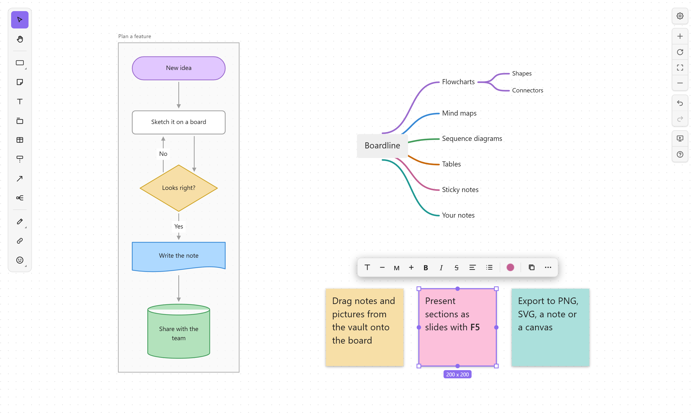

# Boardline

English · [한국어](README.ko.md)

Whiteboards inside your Obsidian vault. Draw flowcharts, mind maps, sequence diagrams, tables and sticky notes, and put your notes, pictures and other boards right on the board. Each board is one `.board` file in your vault: no server, no account. Works on desktop, phones and tablets.



## Features

- **Flowcharts**: rectangles, pills, circles, diamonds, parallelograms, trapezoids, triangles, hexagons, cylinders, flowchart symbols (document, multiple documents, predefined process, manual input, delay, display), braces, clouds and stars. Twelve colors, four styles, and your own colors.
- **Connectors** that route themselves around shapes: elbow, straight or curved, with labels, arrowheads and dashes. Attach an end anywhere along a shape's border, drag any segment, or loop a line back to the same shape.
- **Mind maps**: `Tab` adds a child, `Enter` a sibling. Layout and branch colors are automatic; drop a node next to another to make it a child, and `/` folds a branch.
- **Sequence diagrams**: actors with lifelines, messages that follow their actors, reordering by dragging.
- **Tables** with header rows, Markdown in cells and resizable columns.
- **Sticky notes, text, sections, groups and locking.** Sections are frames that carry what's inside them. Select several objects and drag a corner or an edge of their box to resize them together; Shift keeps proportions and Alt resizes from the middle, for one object too.
- **Drawing**: pen, highlighter, eraser and lasso.
- **Icons**: 1,500+ [Phosphor](https://phosphoricons.com) icons in three styles.
- **Your vault on the board**: notes as live cards with rendered Markdown, pictures, other boards and canvases, and web links with previews. Moving or renaming a file updates every board that shows it.
- **Markdown text**: bold, italic, strikethrough, highlight, code, headings, lists and tasks, the same syntax as your notes.
- **Mermaid**: paste a flowchart, sequence diagram or mind map to turn it into board objects; copy a selection back as Mermaid.
- **Auto layout** of flowcharts (`Shift+Alt+V` top to bottom, `Shift+Alt+H` left to right).
- **Find and replace**, **version history**, and **presenting** sections as slides with a laser pointer (on desktop).
- **Export** to PNG, SVG, a Markdown note or an Obsidian canvas, and embed a board in a note with `![[My board.board]]`.
- Follows Obsidian's light or dark theme, accent color and interface font.

## Getting started

- **New board**: the ribbon's board icon, **Boardline: New board** in the command palette, or right-click a folder in the file explorer.
- **Open a board**: click any `.board` file.
- **Every shortcut** is in the board's help: press `?` (`Shift+/`) or the help button at the right edge.
- **Commands**: presenting, find and replace, version history, zoom, auto layout, export and Mermaid import are also commands (**Boardline: …** in the command palette). They have no hotkeys of their own; give them any in **Settings → Hotkeys**.

| Key | Tool | Key | Tool |
|---|---|---|---|
| `R` | Rectangle | `N` | Sticky note |
| `T` | Text | `.` | Section |
| `C` | Connector | `M` | Mind map |
| `Q` | Sequence actor | `E` | Table |
| `H` / `Shift+H` | Pen / highlighter | `X` | Icon |
| `K` | Link | `I` | Picture |
| `F5` | Present | `Esc` | Back to select |

`Ctrl` shortcuts also work with `Cmd` on macOS. Single-letter shortcuts follow the key, so they work with Korean, Japanese and other input modes.

The board's own shortcuts work while a board has focus, like Obsidian's canvas, so they aren't listed in Settings → Hotkeys. While a board has focus, it uses a few keys that Obsidian also uses (`Ctrl+B/I/E/F/H/G/D/L/0/=/-`, `Ctrl+Enter`, `Alt+Enter`) for the same kind of action on the board: bold, italic, find, group and so on. Outside the board they work as usual.

## Where your data lives

- **Boards**: `Name.board` files in your vault. They're JSON with a header on the first line and one object per line, so a change shows up as a one-line diff in Git and syncs like any other file.
- **Pictures** you paste, preview images of web links, and PNG and SVG exports go to your attachment folder (Obsidian's setting), named by their content so each is stored once.
- **Version history**: `.boardline/history/<board id>/` in your vault, up to 100 versions per board. Obsidian's Vault API doesn't list hidden folders, so Boardline reads and writes this one folder with the Adapter API. Hidden folders aren't synced by Obsidian Sync, so history stays on the device where it was made.
- **Per-device preferences** (each board's view, snapping, read-only mode, recent colors and icons): Obsidian's local storage for this vault, not in your files.
- **Optional pictures**: with **Keep a picture file next to each board** on, `Name.board.png` is redrawn next to the board for apps that can't show boards.

## Network use

Only link objects use the network. When you add a web address, Boardline reads that page and its images with Obsidian's `requestUrl` to show the title, description, site icon and preview image, and saves the images to your attachment folder. Boardline makes no other network requests, and has no accounts, ads or telemetry.

## Phones and tablets

Boardline runs on Obsidian mobile: one finger works like the mouse, two fingers pan and zoom, and on narrow screens the toolbar moves to the bottom. Presenting is left out there, since it ends with Esc. Mobile support is new, so please report anything that doesn't work.

## Languages

English, 한국어, 日本語, 简体中文, Español, Deutsch and Français, following Obsidian's language setting. Other languages show English. Translations and corrections are welcome: each language is one file in [`src/core/i18n/`](src/core/i18n/).

## Installation

Boardline needs Obsidian 1.8.7 or later.

- **Community plugins** (once listed): **Settings → Community plugins → Browse**, search for "Boardline", then install and enable it.
- **Manually**: download `main.js`, `manifest.json` and `styles.css` from the [latest release](https://github.com/kjs104901/obsidian-boardline/releases/latest) into `<vault>/.obsidian/plugins/boardline/`, reload Obsidian, and enable Boardline under **Settings → Community plugins**.
- **Beta versions**: add `kjs104901/obsidian-boardline` in [BRAT](https://github.com/TfTHacker/obsidian42-brat).

## Development

Requires Node 22 or later.

```bash
npm install
npm run dev -- --vault /path/to/test/vault
```

`npm run dev` rebuilds on every change and copies the plugin into the vault; reload Obsidian to pick it up.

| Command | Does |
|---|---|
| `npm run build` | Production build: `main.js` and `styles.css` in the repository root |
| `npm run typecheck` | TypeScript |
| `npm run lint` | Obsidian's review rules ([eslint-plugin-obsidianmd](https://github.com/obsidianmd/eslint-plugin)) |
| `npm test` | Unit tests (Vitest) |
| `npm run screenshot` | Redraws `docs/images/board.png` from a demo board (needs Edge or Chrome) |
| `npm run listing` | Redraws the community directory's pictures in `docs/listing/` |
| `npm version patch` | Bumps `package.json`, `manifest.json` and `versions.json`, commits and tags |

Pushing a tag (`git push --follow-tags`) runs the release workflow, which checks, builds and drafts a GitHub release with `main.js`, `manifest.json` and `styles.css`.

The code has three layers: the board engine (`src/core`, no React or Obsidian), the board UI (`src/board-ui`, React) and the Obsidian plugin (`src/*.ts`). See [docs/architecture.md](docs/architecture.md) (in Korean).

## License

[MIT](LICENSE) © 2026 kjs104901

Boardline bundles [elkjs](https://github.com/kieler/elkjs) (EPL-2.0) for auto layout, [React](https://react.dev) (MIT) and [Phosphor Icons](https://phosphoricons.com) (MIT). Their license texts are in the plugin's settings under **Open source licenses**.
